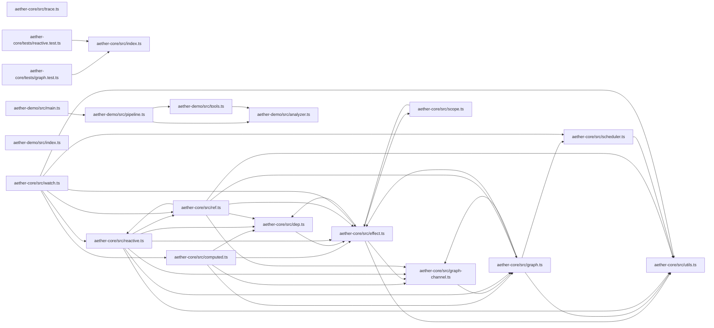

# Aether architecture report

> repo `.` — generated 2026-11-01T02:25:11.393Z
> model `local-architect` · 38 files · 5120 lines · 66 edges

## Architecture (local analysis)

The repository contains **38 modules** and **5120 lines**, wired by **66 internal imports**.

### Load-bearing modules
- `packages/aether-core/src/effect.ts` — 7 dependents, 4 imports
- `packages/aether-core/src/utils.ts` — 6 dependents, 0 imports
- `packages/aether-core/src/graph-channel.ts` — 5 dependents, 1 imports
- `packages/aether-llm/src/types.ts` — 5 dependents, 0 imports
- `packages/aether-core/src/graph.ts` — 4 dependents, 4 imports
- `packages/aether-llm/src/client.ts` — 4 dependents, 4 imports
- `packages/aether-core/src/dep.ts` — 4 dependents, 1 imports
- `packages/aether-llm/src/rate-limiter.ts` — 4 dependents, 0 imports

### Suggested layering
1. **State layer** — pure data modules, imported by many, importing nothing.
2. **Derivation layer** — imports state and exports pure functions.
3. **Effect layer** — entrypoints that perform I/O and are imported by nobody.

### Risks
- No structural red flags detected at this resolution.

### Dependency sketch

